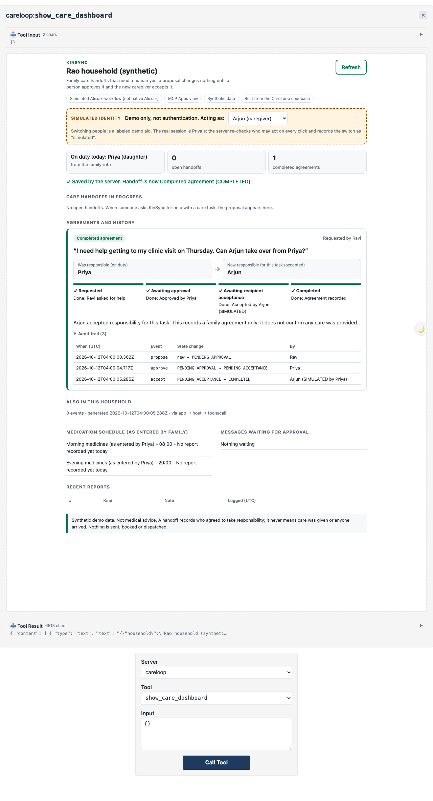

# KinSync

**Care handoffs with no silent transfer of responsibility.**

When a family shares care, the dangerous moment is not the task. It is the handover: two people each believing the other has it. KinSync makes that transfer explicit. A care task moves from one household member to another only when a human approves it **and** the named recipient separately accepts it. Until both have happened, the original person is still responsible, and the system says so in those words.

The second half of the design is the boundary around the model: an AI planner can *propose* a handoff and read household state. It can never approve one, never accept one on someone's behalf, and never send anything. That is enforced in code, not in prompt text.

Built for the Alexa+ track of the Amazon Developer Hackathon 2026. The codebase was created during the submission period (first work 2026-10-05) and still carries its original internal name, `careloop` — the package name, module names and database file are unchanged; KinSync is the product name.

> **Honest scope.** This is an **MCP Apps experience in a simulated Alexa+ workflow**: a real MCP server (protocol 2025-11-25, Streamable HTTP) and a real MCP Apps dashboard running in the official ext-apps reference host, with a rule-based planner standing in for the voice turn. It is **not deployed on native Alexa+**. There is no speech, and no real messaging, booking or dispatch. All people and data are synthetic. KinSync does not give medical advice, and a completed handoff records an agreement — never that care was given.

## For judges: what it does in 60 seconds

1. **Ravi** (the person being cared for) says: *"I need help getting to my clinic visit on Thursday. Can Arjun take over from Priya?"*
2. KinSync reads the family rota, finds today's duty contact (Priya), and **proposes** a handoff to Arjun — an authorized household member resolved against the real roster, never free text. Stored as `PENDING_APPROVAL`.
3. **Priya** (coordinator) approves. It becomes `PENDING_ACCEPTANCE`. **Arjun is not responsible yet, and Priya still is.**
4. **Arjun** accepts. Only now is it `COMPLETED`: a recorded family agreement with a timestamped history.

```
PENDING_APPROVAL --approve--> PENDING_ACCEPTANCE --accept--> COMPLETED
       |                              |
     reject                        decline
       v                              v
   REJECTED                       DECLINED        (end states are final)
```

**No silent transfer.** Both failure paths return custody explicitly rather than dropping it. The server replies `Rejected by Priya. Responsibility is unchanged.` / `Arjun declined. Responsibility is unchanged.` (`src/domain/handoffs.ts`), and the dashboard renders the owner as **Still responsible (on duty)** (`src/ui/handoff-view.ts`). There is no state in which the task is unowned.

**Who may act is decided by the server.** Only the care recipient or the coordinator can approve, and never the proposed recipient (`src/domain/handoffs.ts`, `src/domain/authz.ts`). Only the named recipient can accept. The dashboard does not compute permissions — it reads an `eligible` set the server derives from the same rules it enforces, so a button cannot offer an action the server would refuse.

### The model boundary, and where refusals are recorded

A request can be refused in two different places, and the two are recorded differently. This distinction matters when reading the evidence:

| Where | What it refuses | Where it is recorded |
|---|---|---|
| **`AgentAdapter`, before the request is sent** (`src/agent/adapter.ts`) | `HUMAN_ONLY_TOOL` (approve/accept/respond are never offered to the model), `TOOL_NOT_ALLOWED` (anything off the allowlist), `VERBATIM_REQUIRED:<field>` (words quoted to family must come from the user's own utterance) | The **tool-call trace** (`careloop.tool-trace/v1`) as `decision: "policy_denied"`, `effective_args: null`, `outcome: "not_called"`. **Not in the server audit trail — the server never received the call.** |
| **`CareService`, at the server** (`src/domain/service.ts`) | Unknown or missing actor, blocked simulated actor, role/household authorization failure, schema validation failure, and any error raised inside a mutation | The **server audit trail** (`audit_events`, via `auditTrail(householdId)`) with outcome `denied` or `invalid`, written in the same transaction and then re-thrown |

Both layers are exercised by a test that runs a *deliberately compromised* planner against an instruction planted in household data (`test/agent-security.test.ts`). It obeys the injected note and tries to approve every pending approval, write to another household, and send an SMS. All three are refused — `HUMAN_ONLY_TOOL`, `VERBATIM_REQUIRED:note`, `TOOL_NOT_ALLOWED` — the outbox stays empty, the approval stays `pending`, and no row is written to the other household. The test asserts the approval attempt produced **no** server audit entry, precisely because the adapter stopped it before the wire.

Timed walkthrough: [docs/DEMO_SCRIPT.md](docs/DEMO_SCRIPT.md). Evidence: [docs/PHASE5_DEMO_REPORT.md](docs/PHASE5_DEMO_REPORT.md).

### See it working (latest evidence: Phase 6A, from a clean clone)

A fresh copy of exactly the files in this repository was installed and run end to end: install, typecheck, **221/221 tests**, reference-host setup, `pnpm demo`, and a server restart. Everything is in [`evidence/phase6/clean-clone/`](evidence/phase6/clean-clone/):

- Completed agreement, desktop: [`32-completed-desktop.png`](evidence/phase6/clean-clone/32-completed-desktop.png) · phone width: [`32-completed-narrow.png`](evidence/phase6/clean-clone/32-completed-narrow.png)
- Still there after a server restart: [`40-after-restart-desktop.png`](evidence/phase6/clean-clone/40-after-restart-desktop.png)
- The spoken request and every tool call, as printed by `pnpm demo`: [`demo-console.txt`](evidence/phase6/clean-clone/demo-console.txt) · restart: [`demo-keep-console.txt`](evidence/phase6/clean-clone/demo-keep-console.txt)
- Test run from the clean clone: [`vitest-full.txt`](evidence/phase6/clean-clone/vitest-full.txt)



Run it yourself: [Quick start](#quick-start-local-0-no-accounts-or-api-keys) below (`pnpm demo`). Submission status: [docs/SUBMISSION_CHECKLIST.md](docs/SUBMISSION_CHECKLIST.md).

## Quick start (local, $0, no accounts or API keys)

Requirements: **Node.js >= 22.13** (built-in `node:sqlite`; developed on 26.3.0), **pnpm 11**, **git**, **npm**, and **[bun](https://bun.sh)** (serves the reference host). Chromium for the automated browser checks: `pnpm exec playwright install chromium`.

```bash
pnpm install
scripts/setup-basic-host.sh        # one time: fetch and build the official MCP Apps reference host (pinned commit) into hosts/
pnpm demo                          # fresh synthetic DB + MCP server :3333 + reference host :8080; press Enter to play Ravi's request
```

Then open the printed dashboard URL (`http://localhost:8080/index.html?server=careloop&tool=show_care_dashboard&call=true`), press **Refresh**, **Approve** as Priya, switch the clearly labeled **SIMULATED identity** selector to Arjun, and **Accept**. Stop with Ctrl+C.

```bash
pnpm demo -- --keep                # restart on the same DB: the completed agreement and audit trail are still there
pnpm demo -- --planner ollama      # EXPERIMENTAL: a local Ollama model (already pulled, e.g. llama3.1) plans the request; no fallback
pnpm demo -- --smoke               # non-interactive self-check (used for the evidence run)
```

The demo pins its clock to start at Monday 2026-10-12 09:30 (Asia/Kolkata) and then runs in real time, so the synthetic rota always puts Priya on duty whatever day you record. The banner says so.

## Architecture

```
 "I need help..."            (simulated voice turn)
        |
        v
 Planner ---- deterministic rule-based (default)  |  EXPERIMENTAL local Ollama  |  Claude (opt-in, never run)
        |  proposes tool calls only
        v
 AgentAdapter  -- allowlist: propose_handoff, get_handoffs, ... ; human-only tools denied in code;
        |          household + idempotency key set by the app, not the model; quoted words must be verbatim
        |  MCP (Streamable HTTP, protocol 2025-11-25, session-bound synthetic actor)
        v
 MCP server (src/server.ts) --- tools ---> CareService (validate -> authorize -> one SQLite transaction:
        |                                    state change + idempotency record + audit row)
        |                                    handoffs.ts / handoff-state.ts (state machine, eligibility)
        |  ui:// resource + show_care_dashboard
        v
 MCP Apps view (sandboxed iframe in the reference host): Approve / Reject / Accept / Decline call
 decide_handoff / respond_to_handoff through the host's tools/call; the server decides, the view re-renders.
```

| Layer | Who decides | Notes |
|---|---|---|
| Understanding the request | Rule-based planner by default (**not an LLM**); optional local LLM (experimental) | Asks instead of guessing when intent or recipient is unclear |
| Proposing a handoff | The planner, through the adapter's policy | Can only propose; recipient resolved against the real roster |
| Approve / reject | A human: care recipient or coordinator, never the proposed recipient | Human-only tool |
| Accept / decline | A human: exactly the proposed recipient | Human-only tool |
| State, permissions, idempotency, audit | Deterministic server code | Same rules whatever the planner or UI says |

Identity is **synthetic**: each MCP session carries a member id in the `X-CareLoop-Actor` header (not authentication). A browser host cannot send that header, so the demo's browser session acts as Priya, and the dashboard can *simulate* other members of the same household only when the server runs with `CARELOOP_SIMULATED_ACTORS=1`. Those actions are labeled "simulated" in the UI, the transition row and the audit trail, and AI adapter sessions can never use it.

## Verify

```bash
pnpm typecheck
pnpm test                          # 221 tests: domain, MCP, conformance, agent security, handoff (mocked model; no network)
pnpm scenario                      # 17 checks: original medication + appointment workflow over MCP
pnpm golden && pnpm agent:offline  # golden trace contract for the deterministic planner
pnpm handoff:demo                  # 14 checks: full handoff over real per-person MCP sessions, incl. restart
pnpm verify:render                 # 11 checks: dashboard renders in the official MCP Apps host (Chromium)
pnpm verify:handoff-ui             # 22 checks: full handoff through the real dashboard controls, keyboard-only steps, restart
# With `pnpm demo` running in another terminal: pnpm exec tsx scripts/verify-demo-run.ts  (then --after-restart after `pnpm demo -- --keep`)
```

## Configuration

All settings are environment variables; there are no secrets in the default path. See [.env.example](.env.example) (documentation only; nothing loads a `.env` file automatically).

## Developer reference

```bash
pnpm server                                   # MCP endpoint at http://127.0.0.1:3333/mcp (seeds synthetic data on first run)
CARELOOP_ACTOR=mem_ravi pnpm client tools
CARELOOP_ACTOR=mem_ravi pnpm client call get_household_status '{"household_id":"hh_rao"}'
# Paid, opt-in only (needs ANTHROPIC_API_KEY in your shell; never printed; never used by the demo):
# pnpm eval:live -- --live --case golden [--model claude-haiku-5-5]  (exactly one case per run)
# Free, local, opt-in (needs the Ollama daemon + llama3.1 already pulled):
# pnpm eval:live -- --provider ollama --case golden|status|injection
# pnpm handoff:ollama                        # EXPERIMENTAL: one local-model care-handoff request, single run, no retries

# Manual reference-host run (what pnpm demo automates):
CARELOOP_SIMULATED_ACTORS=1 CARELOOP_DEFAULT_ACTOR=mem_priya CARELOOP_CORS_ORIGINS=http://localhost:8080 pnpm server
(cd hosts/ext-apps/examples/basic-host && SERVERS='["http://127.0.0.1:3333/mcp"]' bun serve.ts)
```

Seeded synthetic members: `mem_ravi` (care recipient), `mem_priya` (coordinator), `mem_arjun` (caregiver), `mem_meera` (viewer) in `hh_rao`; `mem_lin`, `mem_wei` in `hh_chen` (used to prove household isolation).

### MCP Inspector

```bash
MCP_CATALOG_PATH=/tmp/inspector.json npx -y @modelcontextprotocol/inspector@2.10.1 --cli http://127.0.0.1:3333/mcp --method tools/list
```

## What's inside

| Path | Purpose |
|---|---|
| `src/domain/` | Domain model: migrations, seed, inputs (zod), authorization policy, safety templates, queries, `CareService` (transactions, idempotency, audit) |
| `src/domain/{handoff-state,handoffs}.ts` | KinSync care handoff: the explicit state machine, and the propose / approve / accept logic, eligibility and read model |
| `src/mcp/` | MCP tool surface (`tools.ts`, now 10 tools plus the dashboard) and the MCP Apps dashboard (`dashboard.ts`) |
| `src/agent/handoff-planner.ts`, `scripts/{handoff-demo,verify-handoff-ui,handoff-ollama}.ts` | Rule-based (not LLM) handoff planner; end-to-end demo, browser check, and the experimental one-shot local-model run |
| `src/agent/scenario.ts`, `scripts/run-scenario.ts` | Deterministic orchestration of the core workflow over MCP, plus its evidence run |
| `src/agent/{policy,adapter,trace,planner}.ts`, `scripts/golden-trace.ts` | Agent adapter (model-facing policy enforcement), trace format, golden contract, deterministic planner |
| `src/agent/{model,runner,output-safety,anthropic-planner}.ts`, `scripts/{live-eval,offline-turn}.ts` | Provider-neutral planner contract, agent loop with budgets and usage log, output safety, Claude planner, gated live eval |
| `src/agent/ollama-planner.ts` | Local, zero-cost `ModelPlanner` over the Ollama HTTP API (`--provider ollama` in `scripts/live-eval.ts`) |
| `src/mcp/schema.ts` | `domainValidated()`: advertise zod JSON Schema, validate in the domain (one error contract) |
| `src/server.ts` | MCP server: binds the session actor from `X-CareLoop-Actor`, registers the domain tools (incl. the four care-handoff tools) and the `show_care_dashboard` MCP App, adds an opt-in CORS allowlist, served over sessionful Streamable HTTP (`NodeStreamableHTTPServerTransport` + `createMcpExpressApp`, localhost bind, Origin validation). Pinned to protocol `2025-11-25`. |
| `src/ui/dashboard.{html,ts}`, `src/ui/handoff-view.ts` | MCP App view (ext-apps `App`): renders tool results; Refresh and every handoff button go through the host's `tools/call` |
| `scripts/build-ui.ts` | Bundles the view into a single HTML file (`dist/ui/dashboard.html`) served as the `ui://` resource |
| `scripts/setup-basic-host.sh`, `scripts/verify-render.ts` | Reference-host setup and automated browser render check |
| `scripts/demo.ts` | `pnpm demo`: one-command local demo (fresh synthetic DB, server, reference host, Ravi's request with a printed tool transcript) |
| `src/client.ts`, `src/cli.ts` | Independent MCP client (`@modelcontextprotocol/client`) that records wire headers |
| `test/` | Domain tests, MCP workflow tests, SDK end-to-end tests, raw-HTTP conformance tests (2025-11-25 transport spec), MCP Apps and CORS tests |
| `evidence/`, `evidence/poc1/`, `evidence/phase2/`, `evidence/phase3a/`, `evidence/phase3b/`, `evidence/phase3d/`, `evidence/phase3e/`, `evidence/phase4/`, `evidence/phase5/` | Captured output, transcripts and screenshots per phase |
| `docs/` | Rules audit, idea shortlist, feasibility, technical plan, PoC-0/PoC-1/Phase 2/3A/3B/3C/3D/3E/4/5 reports, demo script, LLM evaluation plan, local LLM evaluation, domain model, workflow spec, agent security model, agent tool contract, friction log |

## Build history

Each phase has a report in `docs/` and evidence in `evidence/`.

- **PoC-0 / PoC-1:** MCP server and independent client over Streamable HTTP (2025-11-25); MCP Apps dashboard rendered in the official reference host.
- **Phase 2:** domain model, household/role authorization, idempotency, transactions, audit; deterministic medication + appointment workflow stopping at a human approval.
- **Phase 3A-3E:** `AgentAdapter` (allowlist, human-only tools, app-controlled keys, verbatim provenance, untrusted-data envelopes), provider-neutral planner loop with budgets and output safety, gated Claude path (never run, $0), local Ollama path with honest real-inference results and fixes.
- **Phase 4:** KinSync persistent care handoff: state machine, human approval then recipient acceptance, MCP tools, dashboard controls, simulated-actor demo mode. [Report](docs/PHASE4_HANDOFF_REPORT.md).
- **Phase 5:** judge-ready demo polish: redesigned dashboard (4-stage lifecycle, responsive, keyboard-checked), `pnpm demo`, submission hygiene. [Report](docs/PHASE5_DEMO_REPORT.md).
- **Phase 6A:** submission preflight: clean-clone reproducibility (`evidence/phase6/clean-clone/`), fresh-clone install fix (F-46), evidence path sanitization (F-44), submission checklist. [Checklist](docs/SUBMISSION_CHECKLIST.md).

Developer friction encountered along the way, with status and follow-ups: [docs/FRICTION_LOG.md](docs/FRICTION_LOG.md).

## License

MIT. See [LICENSE](LICENSE).
